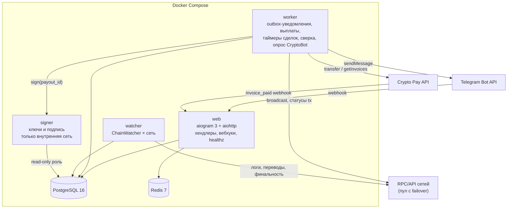
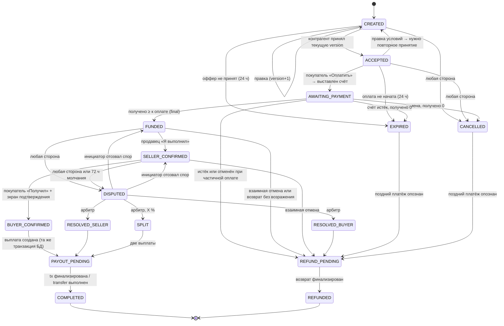
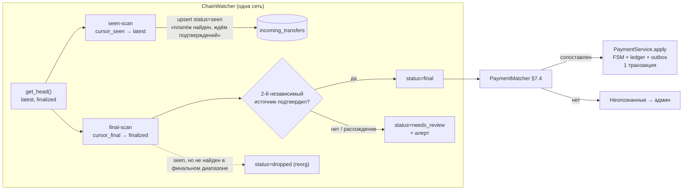

# Escrow-бот «Гарант» — архитектура (черновик на согласование)

> Статус: **согласовано** — реализация идёт по плану из §16.
> Решения заказчика: везде дефолты из §1, кроме двух пунктов —
> **оплата только в USDT** (никаких TON и других активов, курсов и конвертаций нет);
> **одно подтверждение админа во всех случаях**: спор решает один админ (его решение само
> авторизует выплаты), крупная выплата ждёт подтверждения одного админа (`LARGE_PAYOUT_APPROVALS=1`).

---

## 0. Ключевые решения в двух абзацах

Postgres — единственный источник истины. В нём хранятся сделки, платежи, выплаты, ledger и очереди. Переход статуса, проводки ledger, постановка выплаты в очередь и уведомление сторонам выполняются **в одной транзакции** с блокировкой строки сделки (transactional outbox). Redis нужен только для того, что не стыдно потерять: состояние мастера aiogram, rate limit, дедупликация апдейтов, черновики inline-сделок.

Деньги двигаются только по двум путям: **покупатель подтвердил в статусе SELLER_CONFIRMED** или **арбитр вынес решение**. Таймеры умеют только напоминать, открывать спор, отменять неоплаченные сделки и запускать возвраты — выплатить продавцу они не могут. Это правило проверяется в FSM, в сервисе выплат и триггером в БД (defense in depth). Приватные ключи живут только в отдельном контейнере `signer` без выхода в интернет; он сам перепроверяет каждую выплату по БД и лимитам.

---

## 1. Допущения [дефолт]

| Параметр | Значение | Где меняется |
|---|---|---|
| Язык | RU, i18n-каркас сразу (EN — потом без переделок) | `texts/` |
| Объём | до 500 сделок/день, средний чек ~100 USDT, максимум 10 000 USDT | — |
| Комиссия сервиса | 2 %, минимум 1 USDT | `.env` |
| Лимиты суммы | мин. 5 USDT; макс. 10 000; новые пользователи (<3 завершённых сделок) — 300 | `.env` |
| Срок оффера (CREATED) | 24 ч → EXPIRED | `.env` |
| ACCEPTED → начало оплаты | 24 ч → EXPIRED | `.env` |
| Счёт (AWAITING_PAYMENT) | 30 мин, одно продление на 30 мин | `.env` |
| Молчание покупателя после SELLER_CONFIRMED | напоминания каждые 24 ч, автоспор через 72 ч | `.env` |
| Окно возражения продавца на запрос возврата после дедлайна | 12 ч | `.env` |
| Финальность | ETH и BSC — тег `finalized` + мин. N блоков; TRON — solidified; TON — masterchain; SOL — `finalized` | `chains.yaml` |
| Горячий кошелёк | лимит 10 000 USDT на сеть; выплата ≥ 2 000 USDT — подтверждение одного админа; дневной лимит исходящих в signer — 25 000 USDT на сеть | `.env` / signer |
| Переплата | возвращается покупателю (без внутренних балансов) | `.env` |
| Rail сделки | оплата и выплата в одном rail и одной сети (CryptoBot→CryptoBot, TRC-20→TRC-20) | — |

---

## 2. Дыры в ТЗ — говорю прямо

Ниже то, что в текущей формулировке ТЗ приведёт к потере денег или к мошенничеству. Решения уже заложены в архитектуру.

1. **Привязка по tx hash на общем адресе — открытая дверь.** Блокчейн публичен, и любой видит все входящие переводы на наш депозитный адрес. Мошенник открывает сделку с подставным продавцом, присылает чужой tx hash (например, недоплату другого покупателя) и забирает его деньги.
   **Решение:** автопривязка по tx hash только для перевода, который *точно* совпадает с уникальной суммой или комментарием именно этой сделки. Остальное уходит в очередь неопознанных платежей на ручное решение админа. При per-deal адресе проблемы нет: адрес принадлежит сделке.

2. **Возврат на `tx.from` = потеря денег**, если покупатель платил с биржи: `from` — это горячий кошелёк биржи.
   **Решение:** для ончейн-возвратов адрес *всегда* спрашивается у покупателя (валидация формата сети и экран подтверждения). Выплата в статусе `awaiting_address`, пока адреса нет. В CryptoBot возврат идёт на Telegram ID покупателя.

3. **Уникальную сумму нельзя переиспользовать сразу после истечения счёта.** Иначе поздний платёж по сделке A зачислится сделке B.
   **Решение:** метка остаётся зарезервированной ещё 72 ч после истечения (cooldown). Платёж с такой меткой — «поздний платёж» по сделке A.

4. **Один публичный RPC как источник истины.** Взломанный или ошибающийся провайдер может вернуть несуществующий Transfer-лог, и тогда мы «зачислим» фантомный депозит и выплатим продавцу реальные деньги.
   **Решение:** зачисление только после подтверждения из **двух независимых источников** (receipt или транзакция с другого провайдера) плюс регулярная сверка `balanceOf` на финализированном блоке.

5. **`spend_id = deal_id` ломается**, когда по одной сделке несколько переводов: SPLIT (две выплаты), возврат переплаты плюс выплата, разбиение суммы больше лимита CryptoBot.
   **Решение:** `spend_id` берётся из ключа идемпотентности конкретной выплаты (`payout:D123:1`, `refund:D123:1`).

6. **Ретрай ончейн-выплаты новой транзакцией = двойная выплата.**
   **Решение:** подписанная транзакция и nonce сохраняются в БД **до** broadcast. Ретрай рассылает ту же транзакцию повторно, а ускорение делает replace-by-fee с тем же nonce. TRON (нет nonce): переподпись разрешена только после `expiration` + запас и подтверждения по двум источникам, что транзакции нет. TON: тот же seqno и `valid_until`. SOL: проверка `lastValidBlockHeight`.

7. **Inline-карточка в группе: «Принять» может нажать кто угодно.**
   **Решение:** кнопка карточки — это deep link в личку бота. Если контрагент не задан через @username, создатель одним нажатием подтверждает, кто принял («Сделку принял @x — это он?»).

8. **@username ≠ человек.** Username можно сменить, а освободившийся займёт другой. Кроме того, Bot API **не умеет** находить пользователя по @username, если тот не запускал бота.
   **Решение:** сделки привязаны к `user_id`. Username — только подсказка: при принятии сверяется текущий username принимающего. В карточке показывается свежая смена username («сменил username 2 дня назад» — красный флаг). Если пользователь неизвестен боту, выдаётся ссылка-приглашение.

9. **Гонка «правка условий ↔ принятие».** Контрагент нажимает «Принять» на старой версии карточки.
   **Решение:** в callback зашита `version` сделки. Если версия не совпадает, ответ «Условия изменились, проверьте заново».

10. **«Запросить возврат» после дедлайна продавца нельзя исполнять сразу.** Продавец мог передать товар, но забыть нажать «Выполнил»: покупатель получит и товар, и деньги.
    **Решение:** продавцу даётся окно возражения 12 ч. Возражение или «Я выполнил» ведёт в DISPUTED, молчание — в REFUND_PENDING.

11. **Истечение счёта во время ожидания подтверждений.** Платёж найден на 29-й минуте, финализирован на 31-й.
    **Решение:** пока есть подходящий перевод в статусе `seen`, EXPIRED откладывается.

12. **Недоплату на общем адресе с уникальной суммой распознать нельзя**: сумма не совпала — значит, сделка не опознана. Пункт ТЗ «бот покажет, сколько доплатить» работает только там, где есть комментарий (TON), reference (SOL) или per-deal адрес. Для остальных случаев недоплата идёт через очередь неопознанных платежей.
    Кроме того, доплатить 1 USDT с биржи часто невозможно из-за минимального вывода.
    **Решение:** кнопка продавца «Принять недоплату» уменьшает сумму к получению и переводит сделку в FUNDED с записью в аудит.

13. **Биржи режут точность и списывают комиссию из суммы.** Уникальная сумма 150.000137 (6 знаков) с части бирж не отправить, а «к получению» часто считается как сумма минус комиссия.
    **Решение:** метка ставится в 4-м знаке (0.0001–0.0999), в карточке крупно написано «должно прийти ровно…». Для BSC и SOL я рекомендую per-deal адреса (§7.3).

14. **Сетевая комиссия выплаты платится в нативной монете** (BNB/TRX/ETH/TON/SOL), а не в USDT. «Удержать из суммы продавца» на деле означает **фиксированную сумму в USDT по сети** из конфига; она видна в карточке до создания сделки. Реальный газ учитывается отдельно в нативном активе, нативные балансы горячих кошельков мониторятся.

15. **Выплата на наш собственный депозитный адрес** (продавец указал адрес бота или другой сделки) создаст новый «депозит», то есть двойное зачисление.
    **Решение:** адреса наших кошельков запрещены как адреса выплаты и возврата.

16. **Блокировка USDT (Tether blacklist) и AML.** Tether может заморозить наш горячий кошелёк, а входящие средства с «грязных» адресов портят репутацию кошелька на биржах.
    **Решение:** держать на горячем кошельке минимум, регулярно выводить остаток в холодный, опционально проверять крупные депозиты через AML-сервис (бесплатных качественных нет). **Юридически кастодиальный escrow крипты во многих юрисдикциях регулируется (VASP/AML/KYC). Это вопрос к юристу до запуска, не к коду.**

17. **«Зачислить переплату на баланс»** превращает бот в кастодиальный кошелёк: нужны вывод, лимиты и отдельный учёт, растут регуляторные риски.
    **Решение:** возврат переплаты по умолчанию. Мелочь ниже сетевой комиссии возврата уходит продавцу вместе с выплатой, покупатель об этом уведомляется (настраивается).

18. **Компрометация Telegram-аккаунта админа** даёт возможность одобрять выплаты и разрешать споры.
    **Решение:** TOTP-код для денежных действий админа и арбитра; крупная выплата ждёт подтверждения админа. Арбитр не может вести спор, где он сторона, а админ не может одобрить выплату по своей сделке.

19. **Перевод CryptoBot на пользователя, который не запускал @CryptoBot,** не пройдёт.
    **Решение:** выплата уходит в `failed_retryable`, продавец получает «Запустите @CryptoBot и нажмите «Повторить»», админ получает алерт.

20. **Неверная сеть или неверный токен.**
    **Решение:** один и тот же EVM-ключ используется для BSC и ETH, поэтому USDT, отправленный «не в ту EVM-сеть», остаётся под нашим контролем и возвращается вручную. Watcher также следит за «известными чужими токенами» (USDC и т. п.) на наших адресах, чтобы класть их в неопознанные. Нативные монеты (BNB вместо USDT) ловятся сверкой балансов.

---

## 3. Архитектура верхнего уровня



| Процесс | Ответственность | Масштабирование |
|---|---|---|
| `web` | Апдейты Telegram (webhook), вебхук CryptoBot, команды и коллбеки. Пишет в БД только через сервисный слой | N реплик (stateless) |
| `worker` | Очереди на таблицах Postgres (`FOR UPDATE SKIP LOCKED`): `notifications_outbox`, `payouts`, таймеры (`deals.next_action_at`). Периодические задачи под `pg_advisory_lock`: сверка, опрос CryptoBot, освобождение меток | N реплик |
| `watcher` | Один asyncio-таск на сеть, курсоры в `chain_cursors`, лидер на сеть через advisory lock | 1 активный на сеть |
| `signer` | Хранит ключи горячих кошельков, подписывает. Сам перепроверяет выплату в БД, одобрения и дневной лимит. Не делает broadcast и не ходит в интернет | 1 |

**Почему очереди в Postgres, а не arq/Celery.** Постановка выплаты обязана быть атомарной вместе с переходом сделки в PAYOUT_PENDING. Если выплата ставится в Redis после `COMMIT`, падение процесса между ними теряет выплату; если до коммита — получается фантомная выплата. Таблица `payouts` сама служит очередью: статус, `next_attempt_at`, `SKIP LOCKED`. При объёме в сотни сделок в день нагрузка на Postgres ничтожна. Redis-очередь можно добавить позже для неденежных задач, но не для этих.

**Идемпотентность по слоям:**

| Слой | Механизм |
|---|---|
| Апдейт Telegram | `update_id` → Redis `SET NX` с TTL 24 ч |
| Callback | Блокировка строки сделки + охранное условие FSM + `version` в данных кнопки. Повторное нажатие отвечает «уже сделано» |
| Входящий платёж | `UNIQUE (network, tx_hash, event_index)`; для CryptoBot `tx_hash = invoice_id` |
| Выплата | `UNIQUE payouts.idempotency_key` → `spend_id` в CryptoBot / сохранённая подписанная tx ончейн |
| Ledger | `UNIQUE ledger_transactions.idempotency_key` |
| Уведомление | `UNIQUE notifications_outbox.dedupe_key` |

---

## 4. Структура проекта

```
app/
  config.py                 # pydantic-settings: .env + chains.yaml (whitelist токенов, RPC, финальность)
  logging.py                # structlog JSON, фильтр секретов (ключи, токены, адреса не маскируем — они публичны)
  db/
    base.py, session.py     # async engine (asyncpg), UoW
    models/                 # SQLAlchemy 2 typed models
  domain/
    money.py                # Asset, Network, Amount (int minor units), конвертация Decimal↔minor
    fees.py                 # расчёт комиссий — чистые функции
    fsm.py                  # таблица переходов, guards, побочные эффекты (декларативно)
    errors.py
  services/                 # бизнес-операции; каждая = 1 транзакция БД
    deals.py                # create / edit / accept / confirm / cancel / refund-request
    payments.py             # apply_incoming(), matching, недоплата/переплата/поздние
    payouts.py              # создание выплат, approvals, статусы
    disputes.py
    ledger.py               # post(transaction) с проверкой баланса проводок
    notifications.py        # запись в outbox
    antifraud.py            # лимиты, флаги, blacklist
  providers/
    base.py                 # PaymentProvider Protocol + DTO
    cryptobot/              # client.py (Crypto Pay API), provider.py, webhook.py (подпись)
    onchain/provider.py     # OnchainProvider поверх ChainAdapter
  chains/
    base.py                 # ChainAdapter Protocol, ObservedTransfer, ChainHead
    rpc_pool.py             # пул эндпоинтов: health, circuit breaker, ретраи
    watcher.py              # общий цикл ChainWatcher
    evm/                    # bsc + eth (общий адаптер, разные конфиги)
    tron/
    ton/
    solana/
  signer/                   # отдельное приложение (aiohttp на unix-socket / внутренний порт)
  bot/
    handlers/               # start, wizard, commands, inline, deal_actions, deal_chat, disputes, admin
    keyboards/, callbacks.py (CallbackData), texts/ru.py
    middlewares/            # user upsert, rate limit, update dedupe, ban check
  worker/
    runner.py, jobs/        # outbox, payouts, timers, reconcile, cryptobot_poll, tag_release
  web/app.py                # aiohttp: /tg/<secret>, /cryptopay/<secret>, /healthz, /metrics
migrations/                 # Alembic
tests/                      # pytest; Postgres через testcontainers (не SQLite: нужны row locks и partial unique)
docker/, docker-compose.yml, .env.example, chains.example.yaml
```

---

## 5. Конечный автомат сделки



Отзыв спора возвращает сделку в `status_before_dispute`, то есть в FUNDED или SELLER_CONFIRMED.

`BUYER_CONFIRMED`, `RESOLVED_*` и `SPLIT` — **транзитные** статусы. Они фиксируются в журнале аудита, но сделка в них не «висит»: в той же транзакции БД создаются выплаты и сделка переходит в PAYOUT_PENDING или REFUND_PENDING. Итог спора хранится в `disputes.resolution` и `deals.resolution`.

### 5.1. Таблица переходов (авторизация и охрана)

| Из | В | Кто | Охранные условия | Побочные эффекты |
|---|---|---|---|---|
| CREATED | ACCEPTED | контрагент | `version` совпадает; не создатель; если задан `invited_user_id` — совпадает; не в бане; лимиты; продавец указал адрес выплаты (ончейн); если принял «неизвестный» по ссылке — создатель подтвердил его | buyer_id/seller_id, `next_action=accept_ttl` |
| CREATED/ACCEPTED | CREATED | создатель | счёт ещё не выставлен | version+1, контрагенту новая карточка |
| ACCEPTED | AWAITING_PAYMENT | покупатель | — | `create_payment_request`, таймер счёта |
| AWAITING_PAYMENT | FUNDED | system | сумма финализированных зачислений ≥ к оплате; источники подтверждены | ledger: deposit→escrow; дедлайн выполнения; переплата → выплата `overpay_refund` |
| AWAITING_PAYMENT | FUNDED | продавец | частичная оплата, «Принять недоплату» | seller_receives пересчитан, аудит |
| AWAITING_PAYMENT | EXPIRED | system | `expires_at` прошёл; получено 0; нет переводов `seen` | метка в cooldown, CryptoBot `deleteInvoice` |
| FUNDED | SELLER_CONFIRMED | продавец | — | покупателю кнопка «Получил»; таймеры напоминаний и автоспора |
| SELLER_CONFIRMED | BUYER_CONFIRMED → PAYOUT_PENDING | **только покупатель** | второй шаг подтверждения (одноразовый токен, TTL 5 мин) | ledger: escrow→payable+fee; выплата `seller_payout` |
| FUNDED/SELLER_CONFIRMED | REFUND_PENDING | обе стороны | `cancel_req_buyer_at` и `cancel_req_seller_at` заданы | выплата `buyer_refund` (ждёт адрес) |
| FUNDED | REFUND_PENDING | system | покупатель запросил возврат после дедлайна, прошло 12 ч без возражения | то же |
| FUNDED/SELLER_CONFIRMED | DISPUTED | сторона / system | — | средства заморожены (статус), очередь арбитров |
| DISPUTED | RESOLVED_*/SPLIT | арбитр | не сторона сделки; TOTP; комментарий обязателен | выплаты по решению; при сумме > порога нужны approvals |
| PAYOUT_PENDING | COMPLETED | system | все выплаты сделки `confirmed` | ledger: payable→custody; рейтинг |
| REFUND_PENDING | REFUNDED | system | все возвраты `confirmed` | то же |

**Инварианты, которые проверяются кодом и БД:**

- Выплата вида `seller_payout`/`split_seller` создаётся только при переходе в BUYER_CONFIRMED (actor = buyer) или RESOLVED_SELLER/SPLIT (actor с ролью arbitrator, не сторона). Триггер на `INSERT INTO payouts` дополнительно проверяет статус сделки.
- Каждая операция над сделкой выполняется как `SELECT … FOR UPDATE` → проверка → запись → `deal_events` → outbox → `COMMIT`.
- В терминальном статусе баланс `escrow` сделки равен 0 (проверка в периодической сверке).

### 5.2. Таймеры

Отдельный шедулер с per-deal задачами не нужен. В сделке есть колонки `next_action_at` и `next_action_kind`. Worker раз в 15 с выбирает `WHERE next_action_at <= now() … FOR UPDATE SKIP LOCKED` и прогоняет событие через FSM, а FSM вычисляет следующий таймер. Таймер нельзя «потерять», а перезапуск безопасен.

| Статус | Таймер | Действие |
|---|---|---|
| CREATED | `offer_ttl` | EXPIRED |
| ACCEPTED | `pay_start_ttl` | EXPIRED |
| AWAITING_PAYMENT | `expires_at` | EXPIRED / REFUND_PENDING (частичная оплата) / отложить, если есть `seen`-перевод |
| FUNDED | `execution_deadline_at` | покупателю кнопки «Открыть спор» и «Запросить возврат» (деньги не двигаются) |
| FUNDED + запрос возврата | +12 ч | REFUND_PENDING |
| SELLER_CONFIRMED | +24, +48 ч | напоминание покупателю |
| SELLER_CONFIRMED | +72 ч | DISPUTED (reason = buyer_timeout) |
| DISPUTED | SLA 24 ч | алерт арбитрам и админам |

---

## 6. Создание сделки (цель: 30–40 с)

### 6.1. Мастер «Новая сделка»

Одно сообщение редактируется на каждом шаге, чат не засоряется. На каждом шаге есть «Назад» и «Отмена». Состояние мастера хранится в aiogram FSM в Redis с TTL 30 мин.

1. **Роль:** `Я покупатель` / `Я продавец`.
2. **Актив и сеть:** последние использованные сверху: `CryptoBot USDT`, `USDT TRC-20`, `USDT BEP-20`, `USDT TON`, `USDT SOL`, `USDT ERC-20`. У каждой сети — ориентир сетевой комиссии выплаты.
3. **Сумма:** кнопки `10 · 50 · 100 · 500` плюс 3 последние суммы пользователя, либо ввод (`150`, `150.5`, `150,50`). Ошибки понятные: «Минимум 5 USDT», «Для новых аккаунтов максимум 300 USDT».
4. **Условия:** текст 3–2000 символов. Подсказка: «Опишите, что именно и в каком виде передаётся — арбитр будет опираться на это».
5. **Срок выполнения после оплаты:** `1 ч · 24 ч · 3 дня · своё`.
6. **Кто платит комиссию:** `Покупатель · Продавец · Пополам`, с пересчётом сумм прямо на кнопках.
7. **Адрес выплаты** (только если создатель — продавец и сеть ончейн): сохранённые адреса кнопками или ввод с валидацией.
8. **Контрагент:** `Выбрать из контактов` (`KeyboardButtonRequestUsers` даёт `user_id`, это самый надёжный способ), `Ввести @username`, `Недавние контрагенты`, `Получить ссылку-приглашение`.
9. **Предпросмотр карточки** → `Создать`.

После создания: если контрагент известен боту, он сразу получает карточку. Если нет, создатель получает ссылку `t.me/<bot>?start=j_<invite_token>` и кнопку «Переслать». После завершения сделки предлагаются кнопки «Сохранить как шаблон» и «Повторить».

### 6.2. Команда одной строкой

```
/sell @username 150 USDT trc20 Аккаунт Steam с играми, передача логина и почты
/buy  @username 150 usdt Дизайн логотипа, 3 правки
/deal @username 150 USDT Описание          ← бот спросит роль одной кнопкой
```

Сеть необязательна: по умолчанию берётся последняя использованная. Парсер толерантен к регистру, запятой в сумме и порядку `USDT trc20` / `trc20 USDT`. В ответ — предпросмотр с кнопками `Создать` / `Изменить`; недостающие поля (срок, кто платит комиссию) заполняются из последних значений пользователя и видны в предпросмотре.

### 6.3. Inline-режим

`@bot 150 USDT trc20 описание` в любом чате выдаёт **два результата**: «Я продаю» и «Я покупаю». Черновик лежит в Redis с ключом `hash(user_id, нормализованный запрос)` и TTL, поэтому набор текста не плодит сделки. Карточка содержит **URL-кнопку** `Открыть сделку в боте` → `start=i_<token>`, а не callback:

- контрагент обязательно попадает в личку, и бот получает право ему писать;
- адрес выплаты и экраны подтверждения показываются приватно, а не в группе;
- сделка создаётся в БД при первом открытии ссылки. Если в запросе не было @username, создатель подтверждает принявшего одним нажатием.

Бот обновляет inline-сообщение через `inline_message_id` (статус «Принята @x»). Требуется `/setinline` и `/setinlinefeedback` в BotFather.

### 6.4. Карточка сделки

```
🛡 Сделка D7KQ2MXA  ·  ⏳ Ожидает принятия

Покупатель: @alice  — 12 сделок, 0 споров, аккаунт ~3 года
Продавец:   @bob    — новый пользователь ⚠️

Сумма сделки:              100.00 USDT
Комиссия сервиса 2%:         2.00 USDT (платит покупатель)
Сетевая комиссия выплаты:    1.50 USDT (TRC-20, с продавца)
─────────────────────────────────
К оплате:                  102.00 USDT
Продавец получит:           98.50 USDT

Сеть: USDT TRC-20   ·   Срок выполнения: 24 ч после оплаты
Условия: …
Код сделки сверяйте только в @<bot>. Бот никогда не просит перевести деньги на другой адрес или «напрямую».
```

Под карточкой — только кнопки, допустимые для этой стороны в этом статусе. Карточка всегда рендерится из текущего состояния сделки; кнопки в старых сообщениях отвечают «Неактуально, вот текущее состояние».

Формат callback (≤ 64 байт): `d:<action>:<deal_id base36>:<version>`, например `d:acc:1z4k:3`.

---

## 7. Платёжный слой

### 7.1. Абстракция провайдера

```python
class PaymentProvider(Protocol):
    code: ProviderCode  # "cryptobot" | "onchain:tron" | ...

    async def create_payment_request(self, deal: DealSnapshot) -> PaymentInstructions: ...
    async def check_payment(self, req: PaymentRequestRef) -> PaymentCheck: ...  # фоновая сверка
    async def payout(self, order: PayoutOrder) -> PayoutResult: ...  # идемпотентно по order.idempotency_key
    async def refund(self, order: PayoutOrder) -> PayoutResult: ...  # = payout(kind=refund)
    async def get_payout_status(self, order: PayoutOrder) -> PayoutResult: ...  # для «зависших» выплат
    async def get_balance(self) -> list[Balance]: ...
    def validate_destination(self, dest: str) -> str: ...  # нормализованный адрес / user_id
```

Отличия от ТЗ и почему:

- **`refund(order)` вместо `refund(deal)`.** У возврата бывают своя сумма (частичная, переплата, SPLIT) и свой адрес. Сделка не может однозначно задать возврат.
- **Добавлен `get_payout_status`.** После таймаута сети нужно узнать, прошла ли выплата: `getTransfers(spend_id)` у CryptoBot, статус tx ончейн. Без этого либо двойная выплата, либо зависание.

Все суммы — `int` в минимальных единицах актива. `Decimal` используется только на границах: ввод пользователя, API CryptoBot (строки) и отображение. `float` запрещён (`ruff` + тест на запрет).

### 7.2. CryptoBotProvider (MVP)

| Операция | Реализация |
|---|---|
| Счёт | `createInvoice(currency_type=crypto, asset, amount=buyer_pays, payload=<deal_id>:<request_id>, description="Сделка D7KQ2MXA", expires_in=1800, allow_comments=false)`. Храним `invoice_id` и `pay_url` (кнопка «Оплатить в CryptoBot») |
| Вебхук | Проверка `crypto-pay-api-signature` = HMAC-SHA256(тело, ключ = SHA256(токен)), сравнение за константное время. Отбрасываем, если `request_date` старше 10 мин. Ищем запрос по **`invoice_id`** (payload — вторичная проверка). Проверяем `status=paid`, `asset`, `amount == expected` (Decimal), `payload`. Пишем `incoming_transfers(network=cryptobot, tx_hash=invoice_id)` с уникальным индексом, двойной вебхук отсекается. Отвечаем 200 сразу, тяжёлую работу делаем в той же транзакции, но коротко |
| Сверка | Раз в 60 с `getInvoices(invoice_ids=<активные>)` — на случай пропущенного вебхука. Тот же `apply_incoming` |
| Отмена | `deleteInvoice`, только если счёт не оплачен. Если уже оплачен — отмена отклоняется |
| Выплата | `transfer(user_id, asset, amount, spend_id=<idempotency_key>, comment="Выплата по сделке …")`. При таймауте или 5xx — `getTransfers(spend_id=…)`, затем решение. Сумма больше лимита (≈ $25 000) → несколько переводов `…:1`, `…:2` |
| Ошибки выплаты | Пользователь не запускал @CryptoBot / недостаточно средств / сумма вне лимитов (≈ $1–25 000) → `failed_retryable` + уведомление + алерт |
| Баланс | `getBalance` (available + onhold) → сверка с ledger |

Требования: в настройках приложения Crypto Pay включить **Transfers**, задать URL вебхука. Testnet: `@CryptoTestnetBot`, API `testnet-pay.crypt.bot`. **Актуальную комиссию Crypto Pay за приём оплаты нужно проверить до запуска:** если она есть, её нужно заложить в комиссию сервиса.

### 7.3. OnchainProvider: режимы приёма по сетям

В конфиге сети задаётся `deposit_mode`. Идентификаторы складываются по слоям: сначала самый надёжный, затем фолбэк.

| Сеть | Режим по ТЗ | Моя рекомендация | Почему |
|---|---|---|---|
| BEP-20 | общий адрес + уникальная сумма | **per-deal адрес** | Газ на сбор — доли цента. Биржи списывают комиссию из суммы и ломают метку. Минус: нужно сначала отправить BNB на адрес (2 tx) или использовать CREATE2-форвардеры (лучше, но нужен свой контракт — фаза 2) |
| TRC-20 | общий адрес + сумма | общий адрес + сумма, per-deal опционально | Сбор с адреса = активация (~1 TRX) + энергия (делегирование из стейка). Опрос per-deal адресов съедает лимит TronGrid |
| ERC-20 | общий адрес + сумма | общий адрес + сумма | Сбор дорогой |
| TON | комментарий | **комментарий + уникальная сумма как фолбэк** | Кошельки и биржи поддерживают memo. Если комментарий забыли, сумма спасает |
| SOL | reference | **reference + уникальная сумма** (+ per-deal опционально) | Reference добавляют только кошельки с Solana Pay (QR/ссылка), с бирж его нет. Per-deal на SOL дешёвый: аренда ATA возвращается при закрытии |

**Компромисс per-deal HD-адреса** (флаг `deposit_mode=per_deal`):

- **Плюсы:** точная привязка любой суммы, автоматическая недоплата и доплата, работает с любой биржи, tx-claim безопасен, чистый учёт.
- **Минусы:** газ на сбор (sweep), нативная монета на каждом адресе для оплаты газа, больше адресов под мониторингом (на TRON/SOL — больше запросов к API), риск «забытых» адресов.
- **Как смягчаем:** адреса никогда не переиспользуются; sweep батчами по порогу суммы и времени; адреса пишутся в `deposit_addresses` со статусом.

**Уникальная сумма (метка).** Метка — `0.0001…0.0999`, 999 значений на одну базовую сумму. Режим **discount** [дефолт]: метка *вычитается* из суммы к оплате (102.00 → 101.9863), сервис теряет ≤ 0.0999 USDT. Покупатель никогда не платит больше, чем написано в карточке, а минимальная комиссия (1 USDT) больше максимальной метки. Альтернатива — `surcharge`.

Уникальность гарантирует частичный уникальный индекс `(network, asset, deposit_address, expected_amount) WHERE tag_reserved`. Выделение — случайный выбор с повтором при конфликте. Освобождение — периодическая задача по `tag_release_at = expires_at + 72 ч`.

**Платёжные инструкции:** адрес (моноширинно, кнопка «Скопировать»), сумма «ровно», комментарий (TON), QR и ссылки на кошельки:
- `ton://transfer/<addr>?jetton=<master>&amount=…&text=<code>`;
- `solana:<addr>?amount=…&spl-token=<mint>&reference=<ref>&memo=<code>`;
- EIP-681 для EVM.

Рядом жирное предупреждение: сеть, токен, «с биржи — проверьте, что *придёт* ровно эта сумма».

### 7.4. Сопоставление входящего перевода

Сопоставление выполняется только для переводов со статусом `final` (подтверждены двумя источниками). Порядок проверок:

1. `to_address` — per-deal адрес → сделка этого адреса.
2. CryptoBot `invoice_id` → запрос.
3. TON-комментарий или SOL-reference → активный, истёкший или в cooldown запрос.
4. Точная `amount` == `expected_amount` зарезервированной метки на этом адресе.
5. Иначе → `match_status = unidentified` → очередь админа.

Найден запрос:

| Состояние запроса или сделки | Сумма | Результат |
|---|---|---|
| active, AWAITING_PAYMENT | = к оплате | FUNDED |
| active | < к оплате | Остаётся AWAITING_PAYMENT. Покупателю: «получено X, доплатите Y» (комментарий/reference/per-deal: можно доплатить тем же способом). Продавцу: кнопка «Принять недоплату» |
| active | > к оплате | FUNDED + выплата `overpay_refund` (ждёт адрес). Мелочь ниже `dust_threshold` → продавцу вместе с выплатой (уведомление) |
| expired/cancelled (cooldown), сделка EXPIRED/CANCELLED | любая | Поздний платёж → REFUND_PENDING. Покупатель указывает адрес возврата |
| сделка уже FUNDED и далее | любая | Повторная оплата → выплата `overpay_refund` |

### 7.5. Резервный путь: покупатель присылает tx hash

1. `adapter.lookup_tx(hash)` разбирает все переводы в tx на наши адреса по whitelist-контрактам, финальность проверяется двумя источниками.
2. Если перевод уже привязан к другой сделке → отказ (уникальный индекс плюс явная проверка).
3. Если перевод сопоставляется автоматически по правилам §7.4 → привязка (по сути ускорение watcher).
4. **Иначе — только очередь админа** со всеми доказательствами: ожидаемая сумма, фактическая, отправитель, время, другие претенденты на этот hash. Автопривязки по «примерно похожей сумме» нет (см. §2.1).

---

## 8. ChainWatcher

### 8.1. Схема



**Два курсора вместо обработки реорганизаций «на лету».** Деньги зачисляет **только final-scan**: он читает диапазоны не выше финализированного блока, где реорганизаций не бывает. Seen-scan идёт по `latest` и нужен только для UX («платёж найден»), продления таймера счёта и прогресса подтверждений. Если `seen`-перевод не появился в final-scan к моменту, когда финальный курсор прошёл его блок, он помечается `dropped`, а покупатель получает уведомление. Цена решения — двойные вызовы `getLogs`, но они дешёвые. Код получается заметно проще и надёжнее, чем откат курсоров при реорге.

Курсор сохраняется **в той же транзакции**, что и вставка переводов. Повторная обработка диапазона безопасна благодаря уникальному индексу.

### 8.2. Интерфейс адаптера

```python
class ChainAdapter(Protocol):
    network: Network

    async def get_head(self) -> ChainHead: ...  # latest, finalized
    async def scan(self, stream: Stream, cursor: Cursor, upto: Height, *, final: bool) -> ScanPage: ...
    async def verify_transfer(self, t: ObservedTransfer) -> Verification: ...  # 2-й источник
    async def lookup_tx(self, tx_hash: str) -> list[ObservedTransfer]: ...  # tx-claim
    async def token_balance(self, address: str, at_final: bool = True) -> int: ...
    async def native_balance(self, address: str) -> int: ...
    # исходящие
    async def prepare_transfer(self, order: PayoutOrder) -> UnsignedTx: ...  # nonce/seqno/ref block/fee
    async def broadcast(self, raw: bytes) -> str: ...  # на несколько эндпоинтов
    async def tx_status(self, tx_hash: str) -> TxStatus: ...  # pending/final_ok/final_failed/not_found
    def validate_address(self, address: str) -> str: ...
```

### 8.3. Адаптеры по сетям

| | BEP-20 / ERC-20 | TRC-20 | TON (USDT jetton) | SOL (SPL USDT) |
|---|---|---|---|---|
| Контракт (mainnet, whitelist) | BSC `0x55d398326f99059fF775485246999027B3197955`, ETH `0xdAC17F958D2ee523a2206206994597C13D831ec7` | `TR7NHqjeKQxGTCi8q8ZY4pL8otSzgjLj6t` | master `EQCxE6mUtQJKFnGfaROTKOt1lZbDiiX1kCixRv7Nw2Id_sDs` | mint `Es9vMFrzaCERmJfrF4H2FYD4KCoNkY11McCe8BenwNYB` |
| Decimals | **BSC 18**, ETH 6 | 6 | 6 | 6 |
| Источник | JSON-RPC `eth_getLogs(address=USDT, topics=[Transfer, null, pad(our_addr…)])`; для per-deal в `topic2` массив адресов чанками | TronGrid `/v1/accounts/{addr}/transactions/trc20?contract_address=…&only_confirmed=…&min_timestamp=…` (бесплатный ключ) | toncenter v3 `/api/v3/jetton/transfers?owner_address=…&jetton_master=…&direction=in` | RPC `getSignaturesForAddress(<наш ATA>, until=cursor)` + `getTransaction(jsonParsed)` |
| Курсор | номер блока | `block_timestamp` + id на границе | `lt` | последняя сигнатура |
| Финальность | блок ≤ `finalized` и ≥ N подтверждений | solidified (`only_confirmed=true` / `walletsolidity`) | транзакция в masterchain-блоке | commitment `finalized` |
| Проверки | `log.address` ∈ whitelist; `removed=false`; `receipt.status=1`; hash блока = каноническому | `receipt.result=SUCCESS`; лог от USDT-контракта; получатель | `jetton_master` = USDT; получатель — **наш** jetton-wallet (вычислен через `get_wallet_address`); транзакция не aborted; комментарий из `forward_payload` | `meta.err = null`; дельта `pre/postTokenBalances` нашего ATA по mint; reference в `accountKeys` |
| 2-й источник | `eth_getTransactionReceipt` у другого провайдера | `gettransactioninfobyid` у другого fullnode | tonapi или liteserver (pytoniq) | другой RPC |
| Опрос | BSC 3 с, ETH 12 с | 5 с | 5 с | 5 с |

**Защита от поддельного USDT.** Учитываются только логи и переводы от контракта или mint из whitelist. Для TON — только переводы, зачисленные на jetton-wallet, вычисленный от настоящего master: поддельный jetton может прислать `transfer_notification` с любой суммой на основной кошелёк.

**Decimals.** Значения берутся из `chains.yaml` и при старте сверяются с `decimals()` контракта. Расхождение означает отказ запуска. Конвертация выполняется только через `domain/money.py`, тесты покрывают каждую сеть.

### 8.4. RPC-пул (без платных сервисов)

- **Список эндпоинтов в конфиге:** publicnode, 1rpc, llamarpc и т. п.; позже свой нод или бесплатные тарифы с ключом. У каждого эндпоинта указаны поддерживаемые методы: многие публичные RPC режут или отключают `eth_getLogs`, ограничивают диапазон и число результатов.
- **Health и circuit breaker:** EWMA ошибок и латентности, открытие при N ошибках или 429 на T секунд, ротация.
- **Адаптивный диапазон `getLogs`:** при «range too large» диапазон делится пополам, при успехах — растёт.
- **Санити-проверка head:** эндпоинт, отстающий от медианы на > K блоков, исключается из пула.
- **Защита от подмены:** разные провайдеры для чтения и для 2-й проверки, всё через интерфейс. Замена на свой нод — это строка конфига.

### 8.5. Метрики и статус в админке

Метрики: `chain_head{network}`, `chain_cursor_final`, `chain_lag_blocks`, `chain_lag_seconds`, `rpc_errors_total{endpoint,code}`, `rpc_active_endpoint`, `transfers_seen/final/unidentified_total`, `last_error`. Админ видит последний блок, отставание, активный RPC и последние ошибки по каждой сети. Если отставание > порога, приходит алерт.

---

## 9. Выплаты и возвраты

### 9.1. Жизненный цикл выплаты

```
awaiting_address → awaiting_approval → queued → signing → broadcast → confirmed
                                          ↘ failed_retryable (backoff) ↗      ↘ failed_final (алерт, ручное решение)
```

Шаги worker'а для выплаты в `queued`:

1. **Предпроверки:** статус сделки совместим с выплатой; баланс `payable` в ledger ≥ суммы; токен-баланс горячего кошелька ≥ суммы, иначе ждём пополнения и алертим; нативный баланс ≥ оценки газа; получатель не наш адрес и не в чёрном списке; дневной лимит не превышен.
2. **Нонс и seqno:** выделяются из `hot_wallets` под блокировкой строки, а не через `eth_getTransactionCount('pending')` у случайного RPC. Сверка с сетью идёт отдельной задачей.
3. **Подпись:** signer подписывает и возвращает raw tx. `payout_attempts(raw_tx, tx_hash, nonce)` записывается **до** broadcast.
4. **Отправка:** broadcast на 2+ эндпоинта, статус `broadcast`.
5. **Трекинг:** финализировано с `status=1` → `confirmed`, проводки ledger, переход сделки в COMPLETED или REFUNDED. Revert (например, адрес в blacklist Tether) → `failed_final`, nonce израсходован, проводок нет, алерт.

| Сеть | Защита от двойной выплаты | Нюансы |
|---|---|---|
| EVM | Один nonce на выплату. «Застрявшая» tx: повторная рассылка той же tx, затем RBF с тем же nonce и тем же payload | ERC-20 USDT не возвращает `bool` из `transfer` — проверяем по логу |
| TRON | Нет nonce: подпись с `expiration` 10 мин. Новая подпись только после `expiration` + 2 мин и `not_found` в solidified у двух источников | `fee_limit` с потолком. Оценка энергии через `triggerconstantcontract`: у получателя без USDT энергии нужно ~130k против ~65k |
| TON | seqno + `valid_until`. Для параллельных выплат **Highload Wallet v3** (`query_id`), а не v4/v5 | Jetton transfer ≈ 0.05 TON на газ, излишек возвращается. Успех проверяем по jetton transfer с нашим `query_id` |
| SOL | Сигнатура сохраняется; новая подпись только после `lastValidBlockHeight` и `getSignatureStatuses = null` | `createAssociatedTokenAccountIdempotent` (аренда ~0.002 SOL заложена в сетевую комиссию); priority fee. Адрес получателя: если это token account нужного mint — шлём на него, иначе считаем его owner и выводим ATA |
| CryptoBot | `spend_id` = `idempotency_key`; после неопределённого ответа — `getTransfers(spend_id)` | См. §7.2 |

### 9.2. Signer (изоляция ключей)

- **Изоляция:** отдельный контейнер, только во внутренней docker-сети, без выхода в интернет. Read-only роль в БД (`payouts`, `payout_approvals`, `deals`) плюс собственная таблица `signer_log`, куда пишет только он.
- **API:** `POST /sign {payout_id, attempt_no, nonce/seqno/ref_block, fee_params}`. Signer **сам** строит транзакцию из данных выплаты в БД: получателя и сумму от worker'а он не принимает. Он проверяет статус выплаты, наличие нужных одобрений, свои лимиты (на одну tx и за сутки) и то, что получатель не наш адрес.
- **Ключи:** файл зашифрован (age/SOPS), пароль передаётся через Docker secret или KMS-decrypt при старте. Ключи держатся только в памяти signer и никогда не попадают в логи (фильтр structlog + тест). Для secp256k1 (EVM, TRON) возможна подпись прямо в облачном KMS (AWS/GCP поддерживают secp256k1). Для ed25519 (TON, SOL) поддержку в выбранном KMS нужно проверить.
- **Ротация ключей и холодный кошелёк:** излишек сверх лимита горячего кошелька порождает алерт «вывести в холодный» (ручная операция с записью в ledger).

### 9.3. Сетевая комиссия выплаты и энергия TRON

В карточке показывается **фиксированная сумма в USDT по сети** (`network_fee_usdt` в конфиге; админ пересматривает её по текущему газу). Политика `network_fee_payer`: `seller` [дефолт] — вычитается из суммы продавца; `service` — входит в комиссию сервиса. Реальный газ учитывается отдельной проводкой в нативном активе. Расхождение «взяли / потратили» видно в отчёте.

**TRON (USDT-перевод ≈ 65k энергии получателю с USDT и ≈ 130k без).** Цена сжигания сейчас около 100 sun за единицу энергии, то есть ≈ 6.5 / 13 TRX за перевод. Цифры меняются и проверяются по `getchainparameters`. Варианты:

1. **Стейк TRX (Stake 2.0)** — энергия на основном кошельке, нулевая маржинальная стоимость, но капитал заморожен. Объём стейка считается под пиковое число выплат в день.
2. **Аренда энергии на маркетплейсах** — обычно в 1.5–3 раза дешевле сжигания, но это внешний контрагент и API.
3. **Сжигание TRX** — проще всего и дороже всего, служит фолбэком.

Рекомендация: стейк под базовую нагрузку, сжигание как фолбэк с жёстким `fee_limit`, аренда — опционально в фазе 2.

### 9.4. Крупные выплаты

Сумма ≥ `manual_approval_threshold` → статус `awaiting_approval`. Нужно подтверждение **одного** админа, который не является стороной сделки, с вводом TOTP. Отказ возвращает выплату на разбор. Каждое решение пишется в `payout_approvals` и `admin_audit`. Выплаты по решению спора отдельного подтверждения не требуют: решение админа и есть подтверждение.

---

## 10. Комиссии

```
fee        = max(ceil_to_cent(amount × rate), fee_min)      # округление вверх до 0.01, Decimal → minor units
buyer_fee  = fee | 0 | ceil_to_cent(fee / 2)                # buyer | seller | split
seller_fee = fee − buyer_fee
buyer_pays      = amount + buyer_fee                         # (− метка в режиме discount)
seller_receives = amount − seller_fee − network_fee(если платит продавец)
проверка: seller_receives ≥ min_payout (CryptoBot ≈ $1; ончейн — конфиг)
```

Пример: 100 USDT, 2 %, минимум 1, TRC-20 с сетевой комиссией 1.50 (платит продавец).

| Кто платит | К оплате | Продавец получит | Доход сервиса |
|---|---|---|---|
| Покупатель | 102.00 | 98.50 | 2.00 + 1.50 сеть |
| Продавец | 100.00 | 96.50 | 2.00 + 1.50 |
| Пополам | 101.00 | 97.50 | 2.00 + 1.50 |

**Отмена, возврат и спор** [дефолт, в конфиге]: при взаимной отмене и возврате комиссия сервиса не берётся, покупатель получает оплату минус сетевую комиссию возврата. При разрешении спора комиссия удерживается, и арбитр делит остаток (опция «без комиссии» доступна арбитру).

---

## 11. Ledger (двойная запись)

**Активы учёта:** `USDT@tron`, `USDT@bsc`, `USDT@cryptobot`, `TON@cryptobot`, `TRX@tron` (газ) и т. д. Проводки в разных активах между собой не смешиваются.

| Счёт | Тип | Смысл |
|---|---|---|
| `custody:<wallet>` | asset | Средства на нашем горячем кошельке / в приложении CryptoBot |
| `escrow` (deal) | liability | Удерживаемые деньги покупателя |
| `payable` (deal) | liability | Начислено к выплате или возврату, ещё не выплачено |
| `unidentified` | liability | Неопознанные поступления |
| `fee_revenue` | revenue | Комиссия сервиса (минус метки-скидки) |
| `network_fee_recovered` | revenue | Фиксированная сетевая комиссия, удержанная с пользователя |
| `network_fee_expense` | expense | Реальный газ (в нативном активе) |
| `adjustments` | equity | Ручные корректировки: подтверждение админа + аудит |

Проводки для примера: 100 USDT, комиссия 2 % платит покупатель, сеть 1.50 с продавца, метка-скидка 0.0137.

| Событие | Дебет | Кредит |
|---|---|---|
| Депозит финализирован и сопоставлен | `custody:tron` 101.9863 | `escrow[D]` 101.9863 |
| Неопознанный депозит | `custody` X | `unidentified` X |
| …позже привязан админом | `unidentified` X | `escrow[D]` X |
| BUYER_CONFIRMED | `escrow[D]` 101.9863 | `payable[D]` 98.50, `fee_revenue` 1.9863, `network_fee_recovered` 1.50 |
| Выплата финализирована | `payable[D]` 98.50 | `custody:tron` 98.50 |
| Газ (в TRX) | `network_fee_expense` x TRX | `custody:tron` x TRX |
| Возврат / SPLIT | `escrow[D]` | `payable[D]` (по получателям), `fee_revenue` (если удерживается) |

**Инварианты:**

- В каждой ledger-транзакции и по каждому активу Σ = 0 (deferred constraint trigger).
- Балансы `escrow` и `payable` никогда не уходят «в минус» (проверка в сервисе и триггер).
- `escrow[D] = 0` в терминальных статусах.
- Проводки append-only: исправление только сторно.

**Сверка** (раз в 15 мин, под advisory lock): `on-chain balanceOf(горячий кошелёк) @ finalized` сравнивается с `ledger(custody)` − выплатами в полёте + финальными депозитами, ещё не прошедшими обработку. CryptoBot: `getBalance` против `ledger(custody:cryptobot)`. Расхождение два прогона подряд → алерт админам с деталями. Отдельно — нативные балансы для газа (алерт при низком остатке).

---

## 12. Схема БД (PostgreSQL 16)

Суммы хранятся как `numeric(78,0)` в минимальных единицах: `uint256` помещается, а `NUMERIC` точный. Тип `amount` в коде — `int`.

> Реализация: перечисления хранятся как `VARCHAR + CHECK` (а не `CREATE TYPE`) — новое значение
> добавляется обычной миграцией без ограничений `ALTER TYPE`. Актуальная схема — `migrations/versions/0001_initial_schema.py`,
> ниже — эскиз.

```sql
-- ── Пользователи ───────────────────────────────────────────────────────────
CREATE TYPE user_role AS ENUM ('user', 'arbitrator', 'admin');

CREATE TABLE users (
  id                 bigint PRIMARY KEY,                -- Telegram user_id
  username           text,                              -- не UNIQUE: устаревшие данные; при апдейте снимаем у других
  username_changed_at timestamptz,
  first_name         text NOT NULL DEFAULT '',
  language_code      text,
  role               user_role NOT NULL DEFAULT 'user',
  is_banned          boolean NOT NULL DEFAULT false,
  ban_reason         text,
  bot_blocked        boolean NOT NULL DEFAULT false,    -- получили 403 при отправке
  deals_completed    int NOT NULL DEFAULT 0,
  deals_disputed     int NOT NULL DEFAULT 0,
  disputes_lost      int NOT NULL DEFAULT 0,
  volume_usdt        numeric(78,0) NOT NULL DEFAULT 0,  -- в micro-USDT (6 знаков)
  limit_tier         smallint NOT NULL DEFAULT 0,
  totp_secret_enc    bytea,                             -- только admin/arbitrator
  created_at         timestamptz NOT NULL DEFAULT now(),
  last_seen_at       timestamptz NOT NULL DEFAULT now()
);
CREATE INDEX users_username_lower ON users (lower(username));

CREATE TABLE username_history (
  user_id bigint NOT NULL REFERENCES users, username text, seen_at timestamptz NOT NULL DEFAULT now()
);

CREATE TABLE saved_addresses (
  id bigserial PRIMARY KEY, user_id bigint NOT NULL REFERENCES users,
  network text NOT NULL, address text NOT NULL, label text,
  created_at timestamptz NOT NULL DEFAULT now(), last_used_at timestamptz,
  UNIQUE (user_id, network, address)
);

CREATE TABLE blacklist (
  id bigserial PRIMARY KEY, user_id bigint, network text, address text,
  reason text NOT NULL, created_by bigint NOT NULL, created_at timestamptz NOT NULL DEFAULT now(),
  CHECK (user_id IS NOT NULL OR address IS NOT NULL)
);

-- ── Сделки ─────────────────────────────────────────────────────────────────
CREATE TYPE deal_status AS ENUM (
  'CREATED','ACCEPTED','AWAITING_PAYMENT','FUNDED','SELLER_CONFIRMED','BUYER_CONFIRMED',
  'PAYOUT_PENDING','COMPLETED','CANCELLED','EXPIRED','DISPUTED',
  'RESOLVED_BUYER','RESOLVED_SELLER','SPLIT','REFUND_PENDING','REFUNDED');
CREATE TYPE fee_payer AS ENUM ('buyer','seller','split');

CREATE TABLE deals (
  id                    bigserial PRIMARY KEY,
  code                  text NOT NULL UNIQUE,              -- 'D7KQ2MXA': Crockford base32, для людей и TON-комментария
  invite_token          text UNIQUE,                       -- 128 бит, для deep link
  version               int NOT NULL DEFAULT 1,
  status                deal_status NOT NULL DEFAULT 'CREATED',
  status_before_dispute deal_status,
  resolution            text,                              -- buyer|seller|split|mutual_cancel|refund_after_deadline|late_payment
  source                text NOT NULL,                     -- wizard|command|inline|repeat|template
  creator_id            bigint NOT NULL REFERENCES users,
  creator_role          text NOT NULL CHECK (creator_role IN ('buyer','seller')),
  buyer_id              bigint REFERENCES users,
  seller_id             bigint REFERENCES users,
  invited_user_id       bigint,
  invited_username      text,
  terms                 text NOT NULL CHECK (length(terms) BETWEEN 3 AND 2000),
  provider              text NOT NULL,                     -- cryptobot|onchain
  network               text NOT NULL,                     -- cryptobot|bsc|eth|tron|ton|sol
  asset                 text NOT NULL,                     -- USDT|TON|...
  decimals              smallint NOT NULL,                 -- снимок
  amount                numeric(78,0) NOT NULL CHECK (amount > 0),
  fee_payer             fee_payer NOT NULL,
  fee_rate_bps          int NOT NULL,
  fee_min               numeric(78,0) NOT NULL,
  fee_amount            numeric(78,0) NOT NULL,
  network_fee_amount    numeric(78,0) NOT NULL DEFAULT 0,
  network_fee_payer     text NOT NULL DEFAULT 'seller',
  buyer_pays            numeric(78,0) NOT NULL,            -- без метки
  seller_receives       numeric(78,0) NOT NULL CHECK (seller_receives > 0),
  received_amount       numeric(78,0) NOT NULL DEFAULT 0,  -- Σ финальных сопоставленных зачислений
  execution_hours       int NOT NULL CHECK (execution_hours > 0),
  execution_deadline_at timestamptz,
  seller_payout_address text,                              -- ончейн; меняется только до FUNDED
  buyer_refund_address  text,
  next_action_at        timestamptz,
  next_action_kind      text,
  reminders_sent        smallint NOT NULL DEFAULT 0,
  cancel_req_buyer_at   timestamptz,
  cancel_req_seller_at  timestamptz,
  refund_requested_at   timestamptz,
  created_at            timestamptz NOT NULL DEFAULT now(),
  accepted_at           timestamptz, funded_at timestamptz, seller_confirmed_at timestamptz,
  buyer_confirmed_at    timestamptz, closed_at timestamptz,
  updated_at            timestamptz NOT NULL DEFAULT now(),
  CHECK (buyer_id IS NULL OR seller_id IS NULL OR buyer_id <> seller_id)
);
CREATE INDEX deals_next_action ON deals (next_action_at) WHERE next_action_at IS NOT NULL;
CREATE INDEX deals_buyer  ON deals (buyer_id,  created_at DESC);
CREATE INDEX deals_seller ON deals (seller_id, created_at DESC);
CREATE INDEX deals_status ON deals (status);

CREATE TABLE deal_templates (
  id bigserial PRIMARY KEY, user_id bigint NOT NULL REFERENCES users, name text NOT NULL,
  role text NOT NULL, network text NOT NULL, asset text NOT NULL, amount numeric(78,0),
  terms text, execution_hours int, fee_payer fee_payer,
  created_at timestamptz NOT NULL DEFAULT now()
);

-- Журнал аудита: append-only (REVOKE UPDATE/DELETE + триггер-исключение); опционально hash-цепочка
CREATE TABLE deal_events (
  id          bigserial PRIMARY KEY,
  deal_id     bigint NOT NULL REFERENCES deals,
  seq         int NOT NULL,
  actor_type  text NOT NULL,                 -- user|system|arbitrator|admin|provider
  actor_id    bigint,
  action      text NOT NULL,                 -- accept|edit|seller_confirm|buyer_confirm|payment_final|...
  from_status deal_status,
  to_status   deal_status,
  tx_hash     text,
  payload     jsonb NOT NULL DEFAULT '{}',
  prev_hash   bytea, hash bytea,
  created_at  timestamptz NOT NULL DEFAULT now(),
  UNIQUE (deal_id, seq)
);

CREATE TABLE deal_messages (                  -- чат сделки через бота (copyMessage)
  id bigserial PRIMARY KEY, deal_id bigint NOT NULL REFERENCES deals,
  sender_id bigint NOT NULL, sender_role text NOT NULL,   -- buyer|seller|arbitrator
  text text, file_id text, file_type text, flagged text[],
  created_at timestamptz NOT NULL DEFAULT now()
);

-- ── Приём платежей ─────────────────────────────────────────────────────────
CREATE TABLE deposit_addresses (              -- per-deal режим; никогда не переиспользуются
  id bigserial PRIMARY KEY, network text NOT NULL, address text NOT NULL,
  derivation_index int NOT NULL, deal_id bigint REFERENCES deals,
  status text NOT NULL DEFAULT 'assigned',    -- assigned|swept|retired
  created_at timestamptz NOT NULL DEFAULT now(),
  UNIQUE (network, address), UNIQUE (network, derivation_index)
);

CREATE TABLE payment_requests (
  id                 bigserial PRIMARY KEY,
  deal_id            bigint NOT NULL REFERENCES deals,
  provider           text NOT NULL,
  network            text NOT NULL,
  asset              text NOT NULL,
  expected_amount    numeric(78,0) NOT NULL,          -- с учётом метки
  tag_amount         numeric(78,0) NOT NULL DEFAULT 0,
  deposit_address    text,
  deposit_address_id bigint REFERENCES deposit_addresses,
  memo               text,                            -- TON-комментарий (= deals.code)
  sol_reference      text,
  external_id        text,                            -- CryptoBot invoice_id
  pay_url            text,
  fx_rate            numeric(38,18), fx_source text, fx_at timestamptz,
  status             text NOT NULL DEFAULT 'active',  -- active|paid|expired|cancelled
  tag_reserved       boolean NOT NULL DEFAULT false,
  tag_release_at     timestamptz,
  expires_at         timestamptz NOT NULL,
  extended           boolean NOT NULL DEFAULT false,
  created_at         timestamptz NOT NULL DEFAULT now()
);
CREATE UNIQUE INDEX pr_one_active   ON payment_requests (deal_id) WHERE status = 'active';
CREATE UNIQUE INDEX pr_unique_tag   ON payment_requests (network, asset, deposit_address, expected_amount) WHERE tag_reserved;
CREATE UNIQUE INDEX pr_external     ON payment_requests (provider, external_id) WHERE external_id IS NOT NULL;
CREATE UNIQUE INDEX pr_sol_ref      ON payment_requests (sol_reference) WHERE sol_reference IS NOT NULL;
CREATE INDEX        pr_tag_release  ON payment_requests (tag_release_at) WHERE tag_reserved;

CREATE TABLE incoming_transfers (
  id                 bigserial PRIMARY KEY,
  provider           text NOT NULL,
  network            text NOT NULL,
  asset              text NOT NULL,
  token_contract     text,
  tx_hash            text NOT NULL,                   -- CryptoBot: invoice_id
  event_index        int  NOT NULL,                   -- log_index / индекс инструкции / 0
  from_address       text,
  to_address         text NOT NULL,
  amount             numeric(78,0) NOT NULL CHECK (amount > 0),
  memo               text,
  sol_references     text[],
  block_number       bigint, block_hash text, block_time timestamptz,
  status             text NOT NULL,                   -- seen|final|dropped|needs_review
  match_status       text NOT NULL DEFAULT 'pending', -- pending|matched|late|overpaid|unidentified|claimed|resolved
  match_method       text,                            -- invoice|address|memo|reference|amount|tx_claim|admin
  payment_request_id bigint REFERENCES payment_requests,
  deal_id            bigint REFERENCES deals,
  verified_by        text[] NOT NULL DEFAULT '{}',    -- какие источники подтвердили
  raw                jsonb NOT NULL,
  first_seen_at      timestamptz NOT NULL DEFAULT now(),
  finalized_at       timestamptz,
  UNIQUE (network, tx_hash, event_index)              -- защита от повторного использования tx
);
CREATE INDEX it_unidentified ON incoming_transfers (first_seen_at) WHERE match_status = 'unidentified';
CREATE INDEX it_deal ON incoming_transfers (deal_id);

CREATE TABLE tx_claims (                      -- заявки покупателей «вот мой tx hash»
  id bigserial PRIMARY KEY, deal_id bigint NOT NULL REFERENCES deals, user_id bigint NOT NULL,
  network text NOT NULL, tx_hash text NOT NULL, incoming_transfer_id bigint REFERENCES incoming_transfers,
  status text NOT NULL,                       -- auto_matched|pending_review|approved|rejected
  reviewed_by bigint, created_at timestamptz NOT NULL DEFAULT now()
);

CREATE TABLE chain_cursors (
  network text NOT NULL, stream text NOT NULL,          -- stream: 'usdt:<addr>' и т. п.
  cursor_seen text, cursor_final text,                  -- текст: блок / lt / сигнатура / ts+id
  head_latest bigint, head_final bigint,
  last_error text, last_error_at timestamptz, active_endpoint text,
  updated_at timestamptz NOT NULL DEFAULT now(),
  PRIMARY KEY (network, stream)
);

-- ── Выплаты ────────────────────────────────────────────────────────────────
CREATE TABLE hot_wallets (
  id bigserial PRIMARY KEY, network text NOT NULL, address text NOT NULL UNIQUE,
  next_nonce bigint, next_seqno bigint, is_active boolean NOT NULL DEFAULT true
);

CREATE TABLE payouts (
  id                   bigserial PRIMARY KEY,
  idempotency_key      text NOT NULL UNIQUE,           -- 'payout:D123:1' → CryptoBot spend_id (≤64)
  deal_id              bigint REFERENCES deals,
  incoming_transfer_id bigint REFERENCES incoming_transfers,   -- возврат неопознанного
  kind                 text NOT NULL,                  -- seller_payout|buyer_refund|overpay_refund|split_buyer|split_seller|unidentified_return
  provider             text NOT NULL, network text NOT NULL, asset text NOT NULL,
  hot_wallet_id        bigint REFERENCES hot_wallets,
  recipient_user_id    bigint,
  recipient_address    text,
  amount               numeric(78,0) NOT NULL CHECK (amount > 0),
  status               text NOT NULL,                  -- awaiting_address|awaiting_approval|queued|signing|broadcast|confirmed|failed_retryable|failed_final|cancelled
  approvals_required   smallint NOT NULL DEFAULT 0,
  attempts             int NOT NULL DEFAULT 0,
  next_attempt_at      timestamptz,
  last_error           text,
  external_id          text,                           -- CryptoBot transfer_id
  confirmed_tx_hash    text,
  native_fee_spent     numeric(78,0),
  created_at           timestamptz NOT NULL DEFAULT now(),
  updated_at           timestamptz NOT NULL DEFAULT now(),
  confirmed_at         timestamptz
);
CREATE INDEX payouts_queue ON payouts (next_attempt_at) WHERE status IN ('queued','failed_retryable','broadcast');
-- + триггер: seller_payout/split_seller только при deals.status IN ('BUYER_CONFIRMED','RESOLVED_SELLER','SPLIT')

CREATE TABLE payout_attempts (
  id bigserial PRIMARY KEY, payout_id bigint NOT NULL REFERENCES payouts, attempt_no int NOT NULL,
  tx_hash text, raw_tx bytea, nonce bigint, seqno bigint, valid_until timestamptz,
  status text NOT NULL,                       -- signed|broadcast|final_ok|reverted|expired|replaced
  created_at timestamptz NOT NULL DEFAULT now(),
  UNIQUE (payout_id, attempt_no)
);
CREATE UNIQUE INDEX payout_attempts_hash ON payout_attempts (tx_hash) WHERE tx_hash IS NOT NULL;

CREATE TABLE payout_approvals (
  payout_id bigint NOT NULL REFERENCES payouts, admin_id bigint NOT NULL REFERENCES users,
  decision text NOT NULL CHECK (decision IN ('approve','reject')), totp_ok boolean NOT NULL,
  created_at timestamptz NOT NULL DEFAULT now(),
  PRIMARY KEY (payout_id, admin_id)
);

-- ── Ledger ─────────────────────────────────────────────────────────────────
CREATE TABLE ledger_accounts (
  id       bigserial PRIMARY KEY,
  code     text NOT NULL,                     -- custody|escrow|payable|unidentified|fee_revenue|...
  kind     text NOT NULL CHECK (kind IN ('asset','liability','revenue','expense','equity')),
  asset    text NOT NULL,                     -- 'USDT@tron', 'TRX@tron', 'USDT@cryptobot'
  wallet   text, deal_id bigint, user_id bigint,
  balance  numeric(78,0) NOT NULL DEFAULT 0,  -- кэш, обновляется в той же транзакции; истина — entries
  UNIQUE NULLS NOT DISTINCT (code, asset, wallet, deal_id, user_id)
);
CREATE TABLE ledger_transactions (
  id bigserial PRIMARY KEY, idempotency_key text NOT NULL UNIQUE, kind text NOT NULL,
  deal_id bigint, ref_type text, ref_id bigint, meta jsonb NOT NULL DEFAULT '{}',
  created_at timestamptz NOT NULL DEFAULT now()
);
CREATE TABLE ledger_entries (
  id bigserial PRIMARY KEY,
  transaction_id bigint NOT NULL REFERENCES ledger_transactions,
  account_id bigint NOT NULL REFERENCES ledger_accounts,
  asset text NOT NULL,
  amount numeric(78,0) NOT NULL CHECK (amount <> 0)   -- + дебет, − кредит
);
-- CONSTRAINT TRIGGER … DEFERRABLE INITIALLY DEFERRED: Σ amount по (transaction_id, asset) = 0

-- ── Споры, уведомления, админ ──────────────────────────────────────────────
CREATE TABLE disputes (
  id bigserial PRIMARY KEY, deal_id bigint NOT NULL REFERENCES deals,
  opened_by bigint, reason text NOT NULL,     -- user text | buyer_timeout | refund_objection
  status text NOT NULL DEFAULT 'open',        -- open|in_review|resolved|withdrawn
  arbitrator_id bigint REFERENCES users,
  resolution text, buyer_share_bps int CHECK (buyer_share_bps BETWEEN 0 AND 10000),
  keep_fee boolean NOT NULL DEFAULT true, comment text,
  created_at timestamptz NOT NULL DEFAULT now(), resolved_at timestamptz
);
CREATE UNIQUE INDEX disputes_one_open ON disputes (deal_id) WHERE status IN ('open','in_review');

CREATE TABLE notifications_outbox (
  id bigserial PRIMARY KEY, user_id bigint NOT NULL, deal_id bigint,
  kind text NOT NULL, payload jsonb NOT NULL DEFAULT '{}',
  dedupe_key text UNIQUE,
  status text NOT NULL DEFAULT 'pending',     -- pending|sent|failed|skipped
  attempts int NOT NULL DEFAULT 0, next_attempt_at timestamptz NOT NULL DEFAULT now(),
  tg_message_id bigint, last_error text, created_at timestamptz NOT NULL DEFAULT now()
);
CREATE INDEX outbox_pending ON notifications_outbox (next_attempt_at) WHERE status = 'pending';

CREATE TABLE admin_audit (
  id bigserial PRIMARY KEY, admin_id bigint NOT NULL, action text NOT NULL,
  target_type text, target_id bigint, payload jsonb NOT NULL DEFAULT '{}',
  created_at timestamptz NOT NULL DEFAULT now()
);

CREATE TABLE reconciliation_runs (
  id bigserial PRIMARY KEY, wallet text NOT NULL, asset text NOT NULL,
  chain_balance numeric(78,0), ledger_balance numeric(78,0), in_flight numeric(78,0),
  diff numeric(78,0), ok boolean NOT NULL, created_at timestamptz NOT NULL DEFAULT now()
);
```

**Роли БД:** `app` (web, worker, watcher) — DML без DELETE для финансовых таблиц, для `deal_events` и `ledger_entries` только INSERT/SELECT. `signer_ro` — SELECT на выплаты, одобрения и сделки плюс запись в `signer_log`. `migrator` — DDL.

---

## 13. Безопасность и антифрод

- **Авторизация на каждом действии:** callback парсится, сделка блокируется, проверяются «нажавший = нужная сторона», статус и `version`. Данным кнопки не доверяем.
- **Rate limit** (Redis token bucket): 30 действий в минуту на пользователя, 5 новых сделок за 10 мин, 3 tx-claim в час. Глобально соблюдаются лимиты Telegram на отправку (≈ 30 сообщений/с, 1/с в чат) в outbox-воркере.
- **Лимиты для новых аккаунтов:** по числу завершённых сделок. Возраст аккаунта оценивается по монотонности Telegram ID (грубо, только как сигнал).
- **Флаги мультиаккаунтов:** один адрес выплаты или возврата у разных пользователей, сделки «по кругу» между одной парой, свежая смена username. Флаг не блокирует, а виден в карточке и у арбитра.
- **Сделка с собой:** запрет по `user_id` (CHECK в БД) и по совпадению адресов выплаты и возврата.
- **Чёрный список** пользователей и адресов (в том числе для выплат).
- **Чат сделки:** фильтр на реквизиты (номера карт, крипто-адреса, ссылки, @упоминания «гарантов») добавляет предупреждение «Не платите мимо бота».
- **Предупреждения пользователю:** на `/start`, на экране оплаты и на каждой карточке. Официальный бот — только `@<bot>`; статус оплаты определяет только бот, скриншоты не являются доказательством; бот присылает уведомления только по вашим сделкам и никогда не просит перевести деньги на другой адрес, «напрямую» продавцу или «для проверки».
- **Подтверждение покупателя в два шага:** «Получил» → экран «Деньги уйдут продавцу, отменить будет нельзя» → «Да, выплатить» с одноразовым токеном (Redis, TTL 5 мин).
- **Логи:** structlog JSON с `deal_id`, `payout_id` и `request_id`. Процессор-фильтр вырезает поля `*key*`, `*secret*`, `*token*`, а тест проверяет, что секретов в выводе нет. Персональные данные (тексты чата) в логи не пишутся.
- **Вебхуки:** секретный путь, проверка подписи CryptoBot, `secret_token` Telegram (`X-Telegram-Bot-Api-Secret-Token`).
- **Админы и арбитры:** роли в БД, TOTP для денежных действий, подтверждение админа для крупных выплат и корректировок ledger, полный `admin_audit`.

---

## 14. Споры и админ-панель

**Спор.**

- Открыть может любая сторона из FUNDED или SELLER_CONFIRMED; кроме того, спор открывается автоматически при 72 ч молчания покупателя или возражении продавца. Выплаты по сделке заблокированы статусом.
- **Карточка арбитра:** условия и все версии правок, чат сделки (с вложениями по `file_id`), журнал аудита, входящие переводы со ссылками на обозреватели, попытки выплат, рейтинг сторон, флаги антифрода.
- **Действия арбитра:** «Всё покупателю», «Всё продавцу», «Разделить» (25/50/75 % или ввод), «Без комиссии», «Запросить информацию» (сообщение сторонам через бота с пометкой «Арбитр»). Перед решением — экран-сводка, затем TOTP и обязательный комментарий. Стороны получают решение с обоснованием.

**Админка (`/admin`, только роль admin):**

| Раздел | Что внутри |
|---|---|
| Споры | Очередь по возрасту, назначение арбитра, SLA |
| Поиск | По коду сделки, @username / ID, tx hash, адресу |
| Неопознанные платежи | Привязать к сделке (с подтверждением), вернуть на адрес, отметить; tx-claims на проверку |
| Балансы | По сетям: токен и натив на горячем кошельке, ledger, расхождение, последняя сверка |
| Очередь выплат | Статусы, ошибки, «повторить», «отменить» (только до broadcast) |
| Крупные выплаты | Одобрить / отклонить (один админ, TOTP) |
| ChainWatcher | Head, финальный курсор, отставание, активный RPC и ошибки по каждой сети |
| Пользователи | Бан и разбан, лимиты, роли |

---

## 15. Стек и где я предлагаю отойти от ТЗ

| Компонент | Выбор | Почему |
|---|---|---|
| Язык | Python 3.12, `uv`, `ruff`, `mypy --strict` | — |
| Бот | aiogram 3 (webhook) + aiohttp | aiohttp и так внутри aiogram: один веб-фреймворк для вебхуков Telegram и CryptoBot |
| БД | PostgreSQL 16, SQLAlchemy 2 async + asyncpg, Alembic | `NULLS NOT DISTINCT`, partial unique, `SKIP LOCKED` |
| Очереди | **Таблицы Postgres + свой worker**, а не arq/Celery | Транзакционная постановка денежных задач (§3). arq к тому же в режиме поддержки, Celery плохо сочетается с asyncio |
| Redis | Только FSM мастера, rate limit, дедупликация, черновики | Потеря Redis не теряет деньги |
| EVM | Свой async JSON-RPC (httpx) + `eth-abi` + `eth-account` вместо web3.py-провайдеров | Нужно ~7 методов; контроль над failover, квотами и сверкой с двух источников. web3.py избыточен и неудобен для пула эндпоинтов |
| TRON | TronGrid через httpx; `tronpy` только для адресов, сборки и офлайн-подписи | Читать удобнее REST, tronpy-клиент синхронный |
| TON | `tonutils` (Highload Wallet v3, jetton transfer) + `pytoniq-core` (cells, адреса); чтение через toncenter v3, 2-й источник — tonapi или liteserver | Лайт-клиент не индексирует jetton-переводы, а индексатор нужен |
| Solana | `solders` (типы, подпись) + spl-хелперы `solana-py` + свой RPC-клиент | Тот же контроль над failover |
| Логи и метрики | structlog, prometheus-client, Sentry (опционально) | — |
| Тесты | pytest, pytest-asyncio, **testcontainers-postgres**, respx, hypothesis (суммы и комиссии), time-machine | SQLite не умеет row locks и partial unique — тесты на гонки были бы фикцией |

---

## 16. План реализации

| # | Модуль | Статус |
|---|---|---|
| 1 | Каркас, конфиг, модели, миграция с защитными триггерами | ✅ |
| 2 | Ledger | ✅ |
| 3 | Комиссии и распределение escrow | ✅ |
| 4 | FSM и сервис сделок (таймеры, споры, возвраты) | ✅ |
| 5 | Создание сделки в боте: мастер, команды, inline, deep link | ⏳ следующий |
| 6 | CryptoBotProvider | — |
| 7–12 | Хендлеры, админка, фоновые задачи, ChainWatcher, signer, README | — |

Отличия реализации от эскиза выше:

- Приглашение по открытой ссылке: кто первым принял, становится «кандидатом», а создатель подтверждает его одним нажатием.
- «Я выполнил» после запроса возврата трактуется как возражение и открывает спор.
- Если воркер простаивал дольше 72 ч, автоспор открывается сразу, без «досылания» старых напоминаний.
- Действия без смены статуса (запрос отмены, напоминания) — правила `stays` в таблице FSM.


Каждый модуль сдаётся с тестами и коммитом.

1. **Каркас:** конфиг, логирование, модели, миграции, docker-compose. Тесты: миграции up/down, CHECK и уникальные индексы, конвертация decimals по всем сетям.
2. **Ledger.** Тесты: баланс проводок, запрет минуса, идемпотентность, сторно.
3. **FSM и сервис сделок.** Тесты: *все* разрешённые и запрещённые переходы (таблично), запрет «Получил» до SELLER_CONFIRMED, двойное нажатие, конкурентные нажатия (две сессии + `FOR UPDATE`), `version` при правке, взаимная отмена, окно возражения, таймеры.
4. **Комиссии.** Тесты: hypothesis-свойства (`buyer_pays − seller_receives = fee + network_fee`), минимумы, split, округление, метка.
5. **Создание сделки:** мастер, `/sell` `/buy` `/deal`, inline, deep link, шаблоны, повтор. Тесты парсера команд, валидации, привязки контрагента.
6. **CryptoBotProvider.** Тесты: подпись вебхука (валидная и невалидная), двойной вебхук, вебхук и опрос одновременно, неверный актив или сумма, `spend_id`, неопределённый ответ transfer → `getTransfers`.
7. **Хендлеры оплаты и подтверждений, outbox-уведомления.**
8. **Споры и админка, approvals, TOTP.**
9. **Фоновые задачи:** таймеры, сверка, освобождение меток.
10. **ChainWatcher + RPC-пул**, затем адаптеры по одному: **BEP-20 → TRC-20 → TON → SOL → ERC-20**. Тесты: whitelist и поддельный токен, decimals, повторное использование tx, недоплата, переплата, поздний платёж, `dropped` при реорге, расхождение источников → `needs_review`, tx-claim (точный → авто, иначе → админ).
11. **Signer и ончейн-выплаты.** Тесты: повторная рассылка вместо новой tx, nonce, TRON expiration, лимиты signer, запрет выплаты на свой адрес.
12. **README, .env.example, инструкция по testnet** (CryptoBot testnet, BSC testnet / Sepolia с mock-USDT нужных decimals, TRON Nile, TON testnet, Solana devnet), чек-лист рисков перед запуском.

---

## 17. Вопросы (ответы меняют архитектуру)

1. **Юрисдикция и KYC/AML.** Планируется ли KYC или AML-скрининг крупных депозитов? Если да, нужен модуль верификации и хранения ПДн. Без ответа делаю без KYC, но с точками расширения.
2. **Объём и чеки.** Сколько сделок в день, средний и максимальный чек? От этого зависят лимит горячего кошелька, порог ручного подтверждения, ёмкость меток и частота опроса. Дефолты — в §1.
3. **Режим приёма по сетям** (§7.3). Оставляем «общий адрес + метка» как в ТЗ или включаем per-deal для BSC (и SOL)? Моя рекомендация — per-deal для BSC.
4. **Не-USDT активы через CryptoBot (TON и др.).** Цена фиксируется в USDT, курс — на момент счёта. Что получает продавец: **(а)** тот же актив и количество (курсовой риск на продавце, сервис нейтрален; моя рекомендация) или **(б)** эквивалент в USDT (курсовой риск на сервисе, нужен запас USDT)?
5. **Выплата в другой сети, чем оплата** (купил в TRC-20, продавец хочет BEP-20). Предлагаю в MVP запретить: это ребалансировка ликвидности между сетями.
6. **Комиссия** X % и минимум Y. Берётся ли комиссия при взаимной отмене и возврате? Удерживается ли при споре? Дефолты — в §10.
7. **Переплата:** только возврат (рекомендую) или внутренний баланс?
8. **Арбитры и админы.** Сколько их, нужен ли TOTP (рекомендую обязательно)? *Решено: во всех случаях одно подтверждение админа.*
9. **Инфраструктура.** Где хостинг, есть ли Vault или облачный KMS, домен с HTTPS для вебхуков?
10. **Таймауты.** Подтвердите 30 мин / 24 ч / 72 ч и мои дополнительные: оффер 24 ч, окно возражения продавца 12 ч, продление счёта ×1.
11. **Чат сделки** — пересылка через бота с хранением истории для арбитра. Bot API не умеет создавать группы; устраивает?
